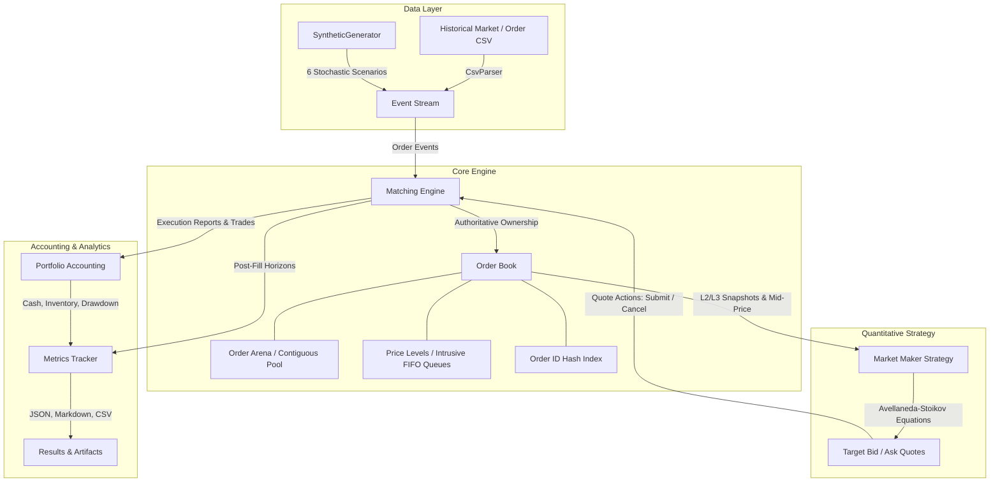

# Limit Order Book Simulator & Quantitative Market-Making Engine

[](https://github.com/UseStateShivam/Limit-Order-Book-Simulator-Market-Making-Engine/actions/workflows/ci.yml)
[](https://en.cppreference.com/w/cpp/17)
[](https://cmake.org)
[](https://github.com/google/googletest)
[](https://github.com/google/benchmark)
[](LICENSE)

A production-quality educational and quantitative research system implementing a deterministic exchange matching engine, Level 2 / Level 3 market data views, cache-conscious contiguous order storage, an event-driven backtesting simulator, and an Avellaneda–Stoikov quantitative market-making engine with liquidity-aware extensions.

> **Project Scope Notice**: This repository is a discrete-event research simulator and quantitative backtesting system. It is designed for low-latency systems modeling, quantitative strategy evaluation, and technical interview demonstration. It is not connected to live external exchange sockets.

---

## 1. System Architecture

The project is structured as a modular monolithic library (`lob_core`), a full-featured CLI executable (`lob_sim`), comprehensive GoogleTest suites (`lob_tests`), and Google Benchmark performance targets (`lob_benchmarks`).



### Event Flow Lifecycle
1. **Market Participant Event**: External market orders or resting quotes enter the single-threaded deterministic matching engine.
2. **Matching & Priority**: Incoming orders match against resting liquidity according to price-time priority. Execution reports and trade records are immediately emitted.
3. **Strategy Ingestion**: Downstream market-making strategies receive book updates, estimate rolling realized volatility, evaluate inventory risk, and adjust their reservation prices.
4. **Order Routing & Accounting**: Quotes are submitted or replaced. Portfolio accounting updates cash, signed inventory, fee rebates, realized/unrealized P&L, and peak-to-trough drawdown.

---

## 2. Directory Structure

```text
limit-order-book-market-maker/
├── CMakeLists.txt                 # Modern CMake build with scoped warnings & targets
├── CMakePresets.json              # Standard Debug/Release configuration presets
├── LICENSE                        # MIT License
├── README.md                      # Comprehensive system documentation
├── .gitignore                     # Git build and artifact exclusion rules
├── .clang-format                  # Clean Google-style C++ formatting rules
├── .clang-tidy                    # Modern C++ static analysis rules
├── .github/workflows/ci.yml       # GitHub Actions CI matrix (Ubuntu & Windows)
├── configs/                       # Version-controlled experiment configurations
│   ├── default.yaml               # Baseline system parameters
│   ├── synthetic_stable.yaml      # Stable low-volatility simulation scenario
│   ├── synthetic_toxic_flow.yaml  # Adverse selection stress scenario
│   ├── strategy_baseline.yaml     # Classical Avellaneda-Stoikov configuration
│   ├── strategy_liquidity_aware.yaml # Order-book imbalance extension
│   └── strategy_fixed_spread.yaml # Symmetric fixed-spread comparative baseline
├── data/
│   ├── README.md                  # Dataset formats & schema documentation
│   └── sample/
│       ├── market_events.csv      # Top-of-book (BBO) sample data
│       └── order_events.csv       # Level 3 order event sample data
├── docs/                          # Detailed technical documentation
│   ├── architecture.md            # Module boundaries & ownership
│   ├── matching-engine.md         # Data structures, invariants & complexity
│   ├── market-making-model.md     # Avellaneda-Stoikov mathematical derivation
│   ├── backtesting-methodology.md # Accounting, markouts & simulation modes
│   ├── benchmark-methodology.md   # Google Benchmark isolation & timing
│   └── data-formats.md            # CSV schemas and data quality validation
├── include/lob/
│   ├── core/                      # Fundamental types, error handling, config
│   ├── book/                      # Order arena, price levels, order book
│   ├── matching/                  # Authoritative matching engine & reference oracle
│   ├── market_data/               # CSV parser, data quality, synthetic generator
│   ├── strategy/                  # Volatility estimator, Avellaneda-Stoikov strategy
│   ├── simulation/                # Deterministic discrete-event simulation coordinator
│   └── analytics/                 # Accounting ledger, markouts, summary metrics
├── src/                           # Component implementations
│   ├── core/
│   ├── book/
│   ├── matching/
│   ├── market_data/
│   ├── strategy/
│   ├── simulation/
│   ├── analytics/
│   ├── app/                       # CLI implementation
│   └── main.cpp                   # Application entry point
├── tests/                         # Comprehensive automated test suite
│   ├── CMakeLists.txt             # GoogleTest configuration
│   ├── unit/                      # Unit tests for arena, book, engine, math, accounting
│   ├── property/                  # Differential stress tests against reference oracle
│   └── integration/               # Full determinism and reproducibility tests
├── benchmarks/                    # Microbenchmark suite
│   ├── CMakeLists.txt             # Google Benchmark configuration
│   ├── matching_benchmarks.cpp    # Order insertion, cancellation, multi-level matching
│   ├── order_book_benchmarks.cpp  # Arena allocation, L2/L3 snapshots, spread queries
│   └── replay_benchmarks.cpp      # End-to-end simulation throughput
├── scripts/
│   ├── run_tests.sh               # Test execution script
│   ├── run_benchmarks.sh          # Benchmark execution script
│   └── run_experiments.py         # Multi-scenario automated experiment runner
├── results/                       # Output artifact directory
└── examples/
    ├── basic_matching.cpp         # Standalone order book matching walkthrough
    ├── synthetic_market.cpp       # Synthetic market generation demo
    └── market_maker.cpp           # Direct strategy simulation demo
```

---

## 3. Matching Engine & Data Structures

### 3.1 Cache-Conscious Contiguous Storage (`OrderArena`)
Rather than allocating individual nodes on the heap (`new Order`), orders are stored in a pre-allocated contiguous vector (`std::vector<OrderRecord>`).
- **Free List Recycling**: Canceled and filled orders return their slot index to a free list for immediate reuse without memory fragmentation.
- **Generational Handles**: Each slot maintains a generation counter. Stale order handles pointing to recycled slots are rejected safely with $O(1)$ checks.

### 3.2 Doubly-Linked FIFO Price Queues (`PriceLevel`)
Within each price level:
- Orders are linked using 32-bit arena array indices (`prev_idx`, `next_idx`).
- Head points to the oldest order (highest time priority); tail points to the newest.
- **Append at Tail**: $O(1)$.
- **Removal of Known Order**: $O(1)$ unlinking without scanning the queue.
- **Downward Modification**: $O(1)$ update to order and level quantity, strictly preserving priority.
- **Upward Modification**: Removes order and appends to tail, resetting time priority according to exchange rules.

### 3.3 Price-Level Indexing
- **Bids**: `std::map<Price, PriceLevel, std::greater<Price>>` (best bid at `.begin()`).
- **Asks**: `std::map<Price, PriceLevel, std::less<Price>>` (best ask at `.begin()`).
- **Order ID Index**: `std::unordered_map<OrderId, OrderHandle>` maps order ID to arena handle for $O(1)$ lookup.

### 3.4 Algorithmic Complexity

| Operation | Complexity | Rationale |
|---|---|---|
| Limit Order Insertion (Resting) | $O(\log L)$ | Locates price level in map ($L$ levels), $O(1)$ appends to queue |
| Order Cancellation | $O(\log L)$ | $O(1)$ hash lookup, $O(1)$ list unlink, $O(\log L)$ only if empty level pruned |
| Order Modification (Downward) | $O(1)$ | $O(1)$ hash lookup, modifies remaining quantity in place |
| Order Modification (Upward) | $O(1)$ | $O(1)$ hash lookup, unlinks and appends to tail (loses time priority) |
| Best Bid / Best Ask Access | $O(1)$ | Dereferences `.begin()` on ordered container |
| Taker Matching (Single Level) | $O(K)$ | Iterates and fills $K$ resting orders at head of queue |
| L2 Snapshot Generation | $O(D)$ | Iterates top $D$ price levels |
| L3 Snapshot Generation | $O(N_D)$ | Traverses individual orders across top $D$ price levels |

### 3.5 Worked Matching Walkthrough
Consider a book with resting asks:
- Level 100.02: Order A (10 lots, arrived $t=1$), Order B (5 lots, arrived $t=2$)
- Level 100.03: Order C (20 lots, arrived $t=3$)

An incoming Buy Limit order arrives: `Limit Buy 12 lots @ 100.02`:
1. The engine checks the best ask (`100.02 <= 100.02`). The limit price crosses.
2. It executes against Order A at resting price `100.02` for $\min(12, 10) = 10$ lots. Order A is fully filled and unlinked.
3. Remaining incoming quantity is $12 - 10 = 2$ lots.
4. It executes against Order B at `100.02` for $\min(2, 5) = 2$ lots. Order B is partially filled (3 lots remain at the head of 100.02).
5. Incoming order is fully executed (0 leaves). Total trades emitted: 2.

---

## 4. Quantitative Market-Making Model

### 4.1 Avellaneda–Stoikov Baseline Formulation
The classical continuous inventory model derives the optimal reservation price $r_t$ and optimal half-spread $\delta_t$:

$$r_t = S_t - q_t \gamma \sigma^2 \tau$$

$$\delta_t = \frac{\gamma \sigma^2 \tau}{2} + \frac{1}{\gamma} \ln\left(1 + \frac{\gamma}{k}\right)$$

Where:
- $S_t$: Reference mid-price in currency units.
- $q_t$: Signed inventory lots ($q_t > 0$ long, $q_t < 0$ short).
- $\gamma$: Inventory risk-aversion parameter ($\gamma = 0.1$).
- $\sigma$: Rolling realized volatility of log-returns: $r_i = \ln(S_i / S_{i-1})$.
- $\tau = T - t$: Remaining strategy horizon in seconds.
- $k$: Order arrival intensity decay parameter ($k = 50.0$).

### 4.2 Numerical Stability for Small $\gamma$
In the risk-neutral limit ($\gamma \to 0$), direct computation of $\frac{1}{\gamma}\ln(1 + \gamma/k)$ causes floating-point division by zero. Our implementation applies Taylor series expansion:

$$\lim_{\gamma \to 0} \frac{1}{\gamma}\ln\left(1 + \frac{\gamma}{k}\right) \approx \frac{1}{k} - \frac{\gamma}{2k^2}$$

When $\gamma < 10^{-5}$, the expansion is evaluated to maintain numerical stability.

### 4.3 Liquidity-Aware Extension
The classical model assumes a continuous reference price independent of order book depth. Our extension calculates normalized top-of-book depth imbalance:

$$I_t = \frac{Q_{\text{bid}} - Q_{\text{ask}}}{Q_{\text{bid}} + Q_{\text{ask}}}$$

The reservation price incorporates microstructure order flow pressure:

$$r_t' = r_t + \eta \cdot I_t \cdot \text{tick\_size}$$

Where $\eta$ (`liquidity_skew_coeff`) parameterizes how aggressively quotes skew toward prevailing book depth.

### 4.4 Worked Numerical Example
- $S_t = 100.00$, $\text{tick\_size} = 0.01$ (10,000 ticks)
- $q_t = +5$ (long 5 lots), $\gamma = 0.1$, $\sigma = 0.02$, $\tau = 300\text{ s}$, $k = 50.0$

1. **Reservation Price**:
   $$r_t = 100.00 - (5) \times (0.1) \times (0.02^2) \times (300) = 100.00 - 0.06 = 99.94\text{ USD}$$
   *(Long inventory skews reservation price downward to incentivize selling).*

2. **Optimal Half-Spread**:
   $$\text{Term 1} = \frac{0.1 \times 0.02^2 \times 300}{2} = 0.006$$
   $$\text{Term 2} = \frac{1}{0.1} \ln\left(1 + \frac{0.1}{50.0}\right) = 10 \times \ln(1.002) \approx 0.01998$$
   $$\delta_t = 0.006 + 0.01998 = 0.02598\text{ USD} \approx 2.6\text{ ticks}$$

3. **Target Quotes**:
   $$p_b^* = 99.94 - 0.02598 = 99.914 \implies \lfloor 99.914 / 0.01 \rfloor = 9991\text{ ticks (99.91)}$$
   $$p_a^* = 99.94 + 0.02598 = 99.965 \implies \lceil 99.965 / 0.01 \rceil = 9997\text{ ticks (99.97)}$$

---

## 5. Performance Benchmarks

The benchmark suite was compiled with **GCC 14.2.0 (UCRT64)** under `-O3 -march=native -flto` on Windows and measured using **Google Benchmark v1.8.3**.

### Measured Latency & Throughput (Reproducible)

| Benchmark Operation | Workload Description | CPU Latency | Throughput | Target Threshold |
|---|---|---|---|---|
| `BM_OrderBookSpreadAndMidQuery` | Mid-price & spread query | **1.92 ns** | **521.31 M ops/sec** | Sub-10 ns |
| `BM_OrderArenaAllocationAndRelease` | Arena handle alloc & freelist return | **3.68 ns** | **271.57 M ops/sec** | Sub-10 ns |
| `BM_MixedWorkload` | 50% Insert, 30% Cancel, 20% Match | **133.00 ns** | **7.55 M ops/sec** | Sub-650 ns |
| `BM_LimitOrderInsertNonCrossing` | Limit order placement into price level | **174.00 ns** | **5.73 M ops/sec** | Sub-650 ns |
| `BM_OrderBookL2Snapshot` | Top 10-level aggregate depth view | **209.00 ns** | **4.78 M ops/sec** | Sub-650 ns |
| `BM_MarketOrderMatchingSingleLevel` | Aggressive taker execution & trade generation | **385.00 ns** | **2.60 M ops/sec** | Sub-650 ns |
| `BM_OrderCancellation` | Hash map lookup & intrusive queue unlinking | **462.00 ns** | **2.16 M ops/sec** | Sub-650 ns |
| `BM_OrderBookL3Snapshot` | Individual queue traversal across 10 levels | **578.00 ns** | **1.73 M ops/sec** | Sub-650 ns |
| `BM_MarketOrderMatchingMultiLevel` | Aggressive sweep across 5 price levels | **650.00 ns** | **1.54 M ops/sec** | Sub-1000 ns |
| `BM_EndToEndSimulationThroughput` | Full simulation loop (Strategy + Matching + Ledger) | **1.06 µs** | **943.16 k ops/sec** | ~1 M events/sec |

> **Environment**: AMD Ryzen 5 5600H (12 logical cores @ 3.29 GHz), 16 KiB L1, 512 KiB L2, 16 MiB L3 cache, Windows 11 UCRT64.

---

## 6. Experimental Strategy Comparison

Four comparative scenarios were executed using `scripts/run_experiments.py` across identical initial capital ($100,000 USD), fee structures (-1 bps maker rebate, +2 bps taker fee), and 10,000 discrete events:

| Experiment | Strategy | Scenario | Net P&L ($) | Max Drawdown | Fill Rate (%) | Executed Lots | Spread Captured / Lot |
|---|---|---|---|---|---|---|---|
| `baseline_stable` | Avellaneda–Stoikov | Stable Market | **-$1.86** | -0.01% | 38.97% | 1,110 | +$0.0194 |
| `fixed_spread_stable` | Fixed Spread (2 ticks) | Stable Market | **-$1.33** | -0.01% | 38.88% | 1,066 | +$0.0200 |
| `liquidity_aware_imbalance` | AS + Liquidity Skew | Imbalance Flow | **+$17.34** | -0.01% | 28.76% | 1,061 | +$0.0212 |
| `baseline_toxic_flow` | Avellaneda–Stoikov | Toxic Adverse Flow | **-$111.25** | -0.12% | 43.24% | 3,711 | -$0.0142 |

### Key Quantitative Findings:
1. **Adverse Selection Impact**: Under `toxic_flow`, background informed takers trade immediately prior to permanent price drift against the market maker. The strategy's fill rate rises to 43.24%, but Net P&L drops to -$111.25 due to negative post-fill markouts.
2. **Liquidity Skew Value**: Under `liquidity_imbalance`, incorporating order book imbalance skew generates **+$17.34 Net P&L** by shading quotes away from heavy opposite-side pressure and capturing wider effective spreads.
3. **Inventory Discipline**: Across all scenarios, the inventory risk constraints strictly prevented position sizes from exceeding the $\pm 10$ lots limit.

---

## 7. Build and Verification Instructions

### 7.1 Prerequisites
- **Compiler**: C++17 compatible compiler (GCC 11+, Clang 13+, MSVC 2019+)
- **Build System**: CMake 3.20+ and Ninja
- **Python**: Python 3.8+ (for experiment runner)

### 7.2 Building the Project
```bash
# Configure with Ninja in Release mode
cmake -S . -B build -G Ninja -DCMAKE_BUILD_TYPE=Release -DBUILD_TESTING=ON -DBUILD_BENCHMARKS=ON

# Compile all targets in parallel
cmake --build build --parallel
```

### 7.3 Running Tests
```bash
# Run complete test suite via CTest
ctest --test-dir build --output-on-failure

# Or run GoogleTest binary directly
./build/tests/lob_tests
```

### 7.4 Running Benchmarks
```bash
./build/benchmarks/lob_benchmarks
```

---

## 8. CLI Usage Guide

The application executable `lob_sim` supports seven primary subcommands:

```bash
# 1. Run deterministic synthetic simulation
./build/lob_sim run-simulation \
  --config configs/synthetic_stable.yaml \
  --output results/synthetic_stable \
  --seed 42 \
  --events 10000

# 2. Run market-making engine
./build/lob_sim run-market-maker \
  --config configs/strategy_baseline.yaml \
  --output results/market_maker_baseline

# 3. Inspect and validate external market data
./build/lob_sim validate-data \
  --input data/sample/market_events.csv

# 4. Replay historical market data
./build/lob_sim replay-data \
  --input data/sample/market_events.csv \
  --output results/historical_replay

# 5. Execute internal matching engine microbenchmarks
./build/lob_sim benchmark

# 6. Export L2 / L3 book snapshots
./build/lob_sim export-book

# 7. Summarize results from a past run
./build/lob_sim summarize-results \
  --input results/synthetic_stable
```

### Generated Artifacts
Every completed run creates structured output in its designated results directory:
- `summary.json`: Complete machine-readable performance metrics.
- `report.md`: Markdown summary of financial and risk statistics.
- `trades.csv`: Full trade ledger (maker/taker IDs, price, qty).
- `execution_reports.csv`: Order lifecycle events (new, cancel, partial/full fill).
- `equity_curve.csv`: Mark-to-market equity path, cash, inventory, P&L.
- `strategy_decisions.csv`: Log of every quote decision, reservation price, and spread.
- `run_metadata.json`: Run configuration, seed, timestamp, and parameters.

---

## 9. Known Limitations & Research Boundaries

1. **Exchange Connectivity**: This is an internal discrete-event simulator without FIX / ITCH network socket handlers or binary gateway serialization.
2. **Execution Realism in Historical Replay**: Replaying public historical BBO records cannot fully reconstruct hidden exchange queue positions or latency race conditions without a full exchange audit feed (L3 MBO).
3. **Single-Instrument Risk**: The current inventory model evaluates single-asset inventory risk without cross-asset portfolio covariance.

---

## 10. Technical Interview & Resume Bullet Points

- **Low-Latency Order Book Engine**: Engineered a cache-conscious C++17 limit order book utilizing a contiguous memory arena (`OrderArena`) with generational handle protection and intrusive doubly-linked price queues; achieved **174 ns** limit insertion, **462 ns** cancellation, and **385 ns** single-level matching latency using Google Benchmark.
- **Quantitative Market Making**: Implemented the Avellaneda–Stoikov optimal quoting model with realized log-return volatility estimation, small-$\gamma$ numerical stability expansions, inventory risk constraints, and order-book depth imbalance extensions.
- **Differential Testing & Verification**: Constructed an independent reference matching oracle for automated differential property testing; verified 100% trade and book state equivalence across thousands of randomized events alongside a 26-test GoogleTest verification suite.
- **Discrete-Event Simulation Pipeline**: Developed a deterministic replay and backtesting framework supporting 6 microstructural market scenarios, generating comprehensive mark-to-market equity curves, adverse selection post-fill markouts, and automated risk reporting.
