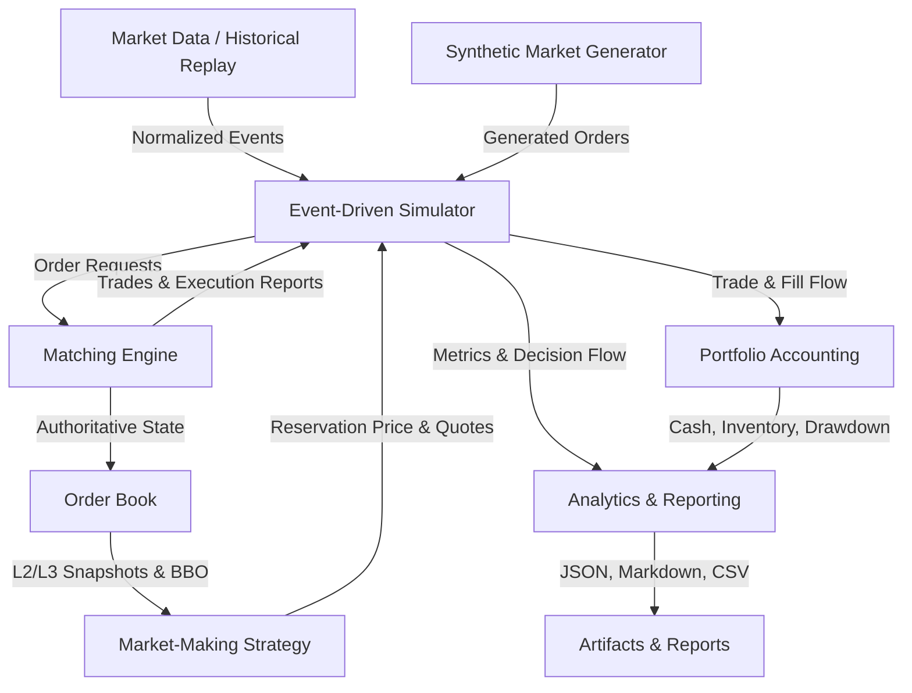

# System Architecture & Design

## 1. Overview and Mission

The **Limit Order Book Simulator & Market-Making Engine** is a high-performance C++17 modular simulation system designed to research exchange matching semantics and quantitative market-making strategies under deterministic microstructural conditions.

## 2. Module Boundaries & Data Ownership

### Module Responsibilities

1. **`lob::core`**: Fundamental types (`Price`, `Quantity`, `OrderId`, `TradeId`, `Timestamp`), error category, and centralized YAML configuration.
2. **`lob::book`**: Authoritative resting order state. Combines a cache-conscious contiguous array (`OrderArena`) with doubly-linked FIFO price queues and ordered price indices (`std::map`).
3. **`lob::matching`**: Exchange matching logic enforcing deterministic price-time priority, limit and market order execution, partial fills, GTC/IOC/FOK enforcement, and invariant validation.
4. **`lob::market_data`**: CSV parsers, normalizers, data quality validators, and a 6-scenario pseudorandom synthetic market generator.
5. **`lob::strategy`**: Implementation of the Avellaneda–Stoikov market-making model, rolling realized volatility estimation, inventory controls, quote replacement thresholding, and top-of-book liquidity imbalance extensions.
6. **`lob::simulation`**: Deterministic simulation coordinator driving the event loop, routing strategy orders to the matching engine, and maintaining simulation time.
7. **`lob::analytics`**: Mark-to-market portfolio accounting, transaction fees/rebates, cash and inventory ledgers, adverse selection post-fill markouts, and automated reporting.

## 3. Determinism and Latency Separation

The matching engine is strictly single-threaded and deterministic. Given identical inputs and random seeds, runs produce byte-for-byte identical trade ledgers and execution reports. Wall-clock timing is isolated to benchmark harnesses and never pollutes engine matching decisions.
